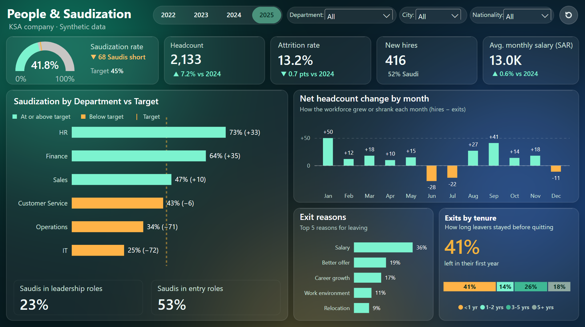
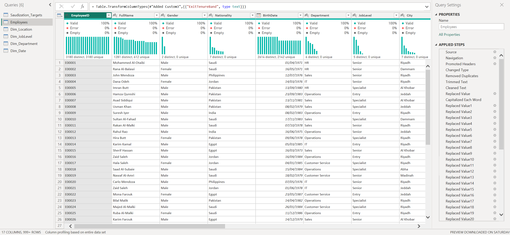
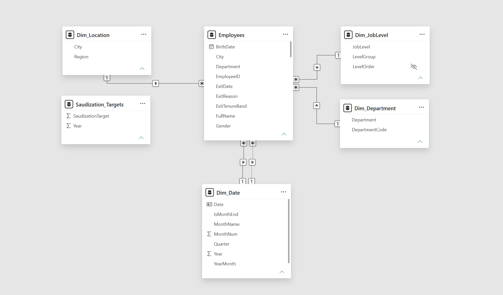

# KSA People & Saudization Dashboard | Power BI

An end-to-end HR analytics project for a Saudi company (2022–2025): workforce size, attrition, hiring and **Saudization against yearly targets**, built in Power BI from raw, messy data to an interactive glass-style dashboard.

🔗 **[View the live interactive dashboard](https://app.powerbi.com/view?r=eyJrIjoiMTM2YWI3YzUtY2FlOC00NGNiLWI5NDYtOGNiM2M3YzVlYzg1IiwidCI6IjJiYjZlNWJjLWMxMDktNDdmYi05NDMzLWMxYzZmNGZhMzNmZiIsImMiOjl9)**

> ⚠️ The dataset is **synthetic** and was created for learning and portfolio purposes. It does not represent any real company. Saudization targets are illustrative and are not official Nitaqat rates.



---

## 🔍 Key Insights (2025)

- **Saudization reached 41.8%** against a 45% target: the company is **68 Saudis short**
- **The gap is widening:** Saudization rose every year (37.3% → 41.8%), but targets rose faster, so the gap grew from 13 to 68
- **Three departments are below target:** IT (25%, −72), Operations (34%, −71) and Customer Service (43%, −6)
- **Saudis hold 53% of entry roles but only 23% of leadership roles**
- **52% of new hires were Saudi**, above the current workforce share, so hiring is moving in the right direction
- **Salary is the top reason for leaving (36%)**; together with "better offer", **55% of exits are pay-related**
- **41% of leavers quit within their first year**, which points to onboarding and early retention
- Exits outpaced hiring in only three months: June, July and December

| Year | Headcount | Saudization | Target | Gap (Saudis) | Hires | Exits | Attrition |
|------|----------:|------------:|-------:|-------------:|------:|------:|----------:|
| 2022 | 1,770 | 37.3% | 38% | −13 | 381 | 260 | 15.2% |
| 2023 | 1,906 | 39.9% | 40% | −3 | 381 | 245 | 13.3% |
| 2024 | 1,989 | 40.3% | 42% | −35 | 353 | 270 | 13.9% |
| 2025 | 2,133 | 41.8% | 45% | −68 | 416 | 272 | 13.2% |

---

## 📊 Dashboard Features

- **Saudization gauge** with the yearly target and a dynamic gap label (▼ short / ▲ above / ● on target)
- **5 KPI cards:** Headcount, Attrition rate, New hires, Avg. monthly salary, each with a color-coded ▲/▼ comparison to the previous year
- **Saudization by department vs target:** bars colored by whether each department meets the target, with the Saudi gap in every label
- **Saudis in leadership vs entry roles**
- **Net headcount change by month** (hires − exits)
- **Top 5 exit reasons**, as a share of all exits
- **Exits by tenure:** how long leavers stayed before quitting
- **Slicers:** Year, Department, City, Nationality
- **Reset button** (bookmark) to return to the default view
- Saudization visuals ignore the Nationality slicer (edited interactions), so the rate never becomes a meaningless 100% when filtering to Saudis

---

## 🧹 Data Cleaning (Power Query)

The source Excel file was intentionally messy. Cleaning steps:



| Issue | Fix |
|-------|-----|
| 24 duplicate employee rows | Removed exact duplicates, then verified `EmployeeID` is unique (3,204 → 3,180 rows) |
| Inconsistent spellings (e.g. department, city, gender and nationality variants) | Replace Values with "Match entire cell contents" |
| Extra spaces and hidden characters | Trim and Clean |
| Leavers with no exit reason | Filled with "Not specified" |
| Missing salaries (19) | Kept as blank so they don't distort the average |

New columns added: `NationalityGroup` (Saudi / Non-Saudi), `Status` (Active / Exited), `ExitTenureBand` (<1 yr, 1-2 yrs, 3-5 yrs, 5+ yrs).

---

## 🗂️ Data Model

Star schema with one fact table and four dimensions, plus a targets table read with `LOOKUPVALUE`.



| Table | Type | Description |
|-------|------|-------------|
| `Employees` | Fact | 3,180 employees: hire/exit dates, exit reason, salary, nationality, department, city, job level |
| `Dim_Date` | Dimension | Calendar 2010–2025 (active relationship to `HireDate`, inactive to `ExitDate`) |
| `Dim_Department` | Dimension | 6 departments |
| `Dim_Location` | Dimension | 7 Saudi cities |
| `Dim_JobLevel` | Dimension | Job levels with order and group (Leadership = Manager, Director) |
| `Saudization_Targets` | Lookup | Yearly Saudization target |

---

## 🧮 DAX Highlights

```dax
-- Headcount at the end of the selected period
Headcount =
VAR d = MAX ( Dim_Date[Date] )
RETURN
    CALCULATE (
        COUNTROWS ( Employees ),
        REMOVEFILTERS ( Dim_Date ),
        Employees[HireDate] <= d,
        OR ( ISBLANK ( Employees[ExitDate] ), Employees[ExitDate] > d )
    )

-- Exits use the inactive relationship on ExitDate
Exits =
CALCULATE ( COUNTROWS ( Employees ), USERELATIONSHIP ( Dim_Date[Date], Employees[ExitDate] ) )

Attrition Rate =
DIVIDE ( [Exits], ( [Headcount Start] + [Headcount] ) / 2 )

Saudization % =
DIVIDE ( [Saudi Headcount], [Headcount] )

Saudi Gap =
ROUNDUP ( [Saudization Target] * [Headcount], 0 ) - [Saudi Headcount]

-- Share of ALL exits, even when the visual shows only the top 5 reasons
Exit Share =
DIVIDE ( [Exits], CALCULATE ( [Exits], ALL ( Employees[ExitReason] ) ) )

-- Respects the Nationality slicer instead of overriding it
New Hires Saudi % =
DIVIDE (
    CALCULATE ( [Hires], KEEPFILTERS ( Employees[NationalityGroup] = "Saudi" ) ) + 0,
    [Hires]
)
```

Measures are organized into display folders: **Core KPIs**, **Saudization**, **Attrition**, **Time Intelligence**, **Display Labels** and **Formatting**.

---

## ✅ Validation

Every KPI was checked against the source data, and all 672 filter combinations (4 years × every department, city and nationality option, including "All") were tested for blank or misleading values. Edge cases were handled explicitly: "On target" when the gap is zero, 0 instead of blank for no hires, and no misleading percentages when filtering by nationality.

---

## 🛠️ Tools

- **Power BI Desktop**: data modeling, DAX, report design
- **Power Query**: data cleaning and new columns
- **TMDL view**: measure development
- **Power BI Service**: publishing
- **Excel**: source data

---

## 📁 Repository Structure

```
├── KSA_HR_Saudization.pbix               # Power BI report
├── KSA_HR_Saudization_Data.xlsx          # Raw dataset (synthetic, with cleaning issues)
├── HR_Glass_Theme.json                   # Custom report theme
├── images3/
│   ├── dashboard.png
│   ├── power_query.png
│   └── data_model.png
└── README.md
```

## ▶️ How to Use

1. Open the **[live dashboard](https://app.powerbi.com/view?r=eyJrIjoiMTM2YWI3YzUtY2FlOC00NGNiLWI5NDYtOGNiM2M3YzVlYzg1IiwidCI6IjJiYjZlNWJjLWMxMDktNDdmYi05NDMzLWMxYzZmNGZhMzNmZiIsImMiOjl9)** in your browser, no install needed
2. Or download the `.pbix` file and open it in Power BI Desktop
3. Pick a year, department, city or nationality; use the ↺ button to reset

---

**Mazen Alqarni** · Data Analyst | Power BI (PL-300)
